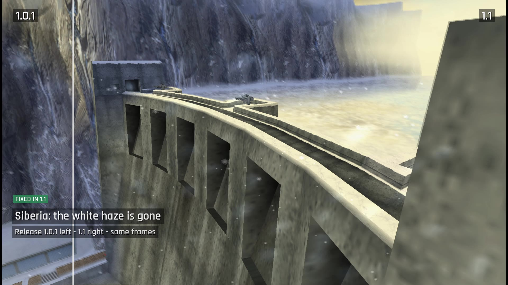
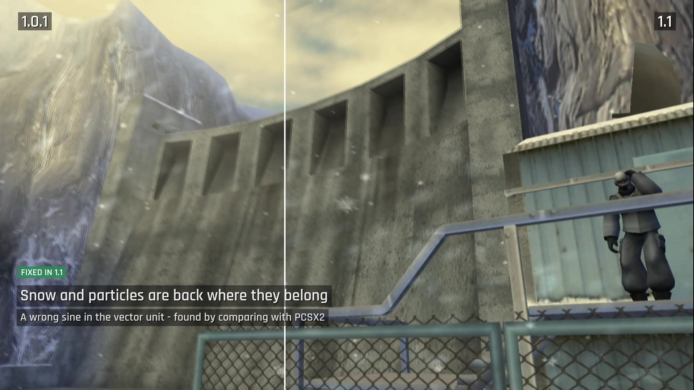

# Version 1.1.0 - patch notes

14 November 2026 · Windows, Linux, Steam Deck

**Please use this version. If you are on 1.0.x, download 1.1 once by hand.** From 1.1 on the launcher checks for new versions when you start it, downloads only the files that changed and backs up your saves first. News like this post show up in the launcher too.

## Highlights

- New launcher with setup, settings, news and automatic updates
- Fog, snow, smoke and debris now look like the original
- The picture fits 16:9, 16:10, 21:9 and 32:9
- Mouse aiming rebuilt
- Everything in English by default

## Graphics

- Fixed: big grey smoke wall when bullets hit a surface
- Fixed: debris pieces far too large
- Fixed: white haze pulsing over the picture in Siberia
- Fixed: snow, sparks, debris and smoke pulled towards the centre in 16:9
- Fixed: HUD jumping inward when smoke or other effects were on screen
- Fixed: black bars at 16:9 on 16:10 screens
- Fixed: Windows laptops with two graphics chips could run the game on the slow one
- New: "Auto" internal resolution (default). Picks a resolution for your screen and steps down on slower cards
- New: menus and HUD in 16:9
- New: sniper scope style - Original, Clear, Extra clear
- New: texture pack support (PCSX2 format, `texture_packs` folder, none included)

## Controls

- Mouse: crosshair fixed in the centre, shots land on it from the first shot, no auto-aim pull
- Mouse: weapons like the Soviet S47 no longer stay zoomed in while aiming
- Mouse: raw input on Linux, choice of crosshair style
- Fixed: sniper scope did not open with mouse aiming
- Fixed: zoom key skipped a level
- New (optional): modern gamepad aiming with a turn speed setting
- New (optional): unlock all levels, characters and cheats without touching your progress

## Launcher and setup

- New launcher for Windows and Linux, English and German
- Setup from your own disc image with a progress display
- Automatic updates: only changed files, saves backed up first, game relinked automatically
- News from the project inside the launcher
- Fixed: launcher always German on Windows
- Fixed: Windows setup asked for the disc image although it was given
- Changed: saves are in `savedata/` at the top of the folder, old saves are moved once

## Online+ (optional, experimental)

- A separate edition you pick in the launcher: own lobby, server browser, quick match, bot match, profile, ranks
- Hit and kill markers, killfeed, scoreboard - all switchable
- A side experiment made with the game's own menus, messages and HUD. The classic game and its multiplayer stay untouched

## Stability

- Fixed: rare black screen or crash while taking screenshots or recording
- Fixed: empty window on some Linux systems (missing library is bundled)
- Fixed: Windows fullscreen - settings menu took clicks at the wrong place
- Crash reports contain useful information, smaller log files

## Known issues

- Mouse aiming: switching back to the sniper rifle can bring the scope up once for a moment
- Online+: the scoreboard does not always count your own kills, bot matches can stutter
- The HUD may still move towards the centre for a moment while damage arcs are drawn (a fix is in, not confirmed yet)
- Impact smoke can show a faint straight edge at very close range
- Windows is tested on one laptop (GTX 1050) and by one tester; AMD and Intel graphics are untested by us
- Full list: [KNOWN_ISSUES](../docs/KNOWN_ISSUES.md)

## Updating

- From 1.0.x: download the new package, extract it into a new folder, set it up once with your disc. To keep saves, copy `app/build/spielstand` from the old folder to `savedata` in the new one
- From 1.1.0 on: the launcher updates by itself

How the smoke bug was found and what went wrong on the way: [Devlog - the road to 1.1](2026-11-14-devlog-road-to-1-1.md)
