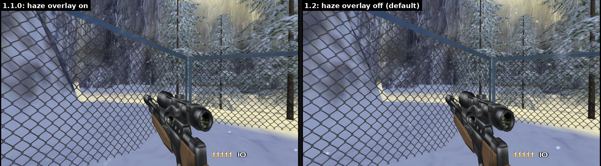
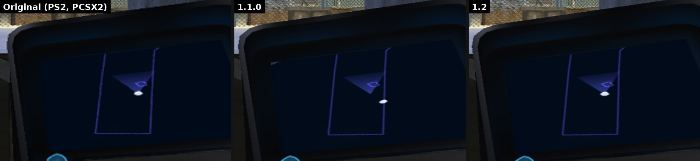

# Devlog: 1.2 is out, what comes next

16 November 2026

1.1.1 grew so much while we worked on it that it became 1.2. Here is a short look behind it and at what comes next.

## The double image

The soft second image in the distance (issue #9) came from the game itself. Every frame TimeSplitters 2 lays a light, slightly shifted copy of the picture over itself as a haze effect. On a PS2 at 480 lines you barely notice it. At 4x or 8x resolution it turns into a clear double image, and PCSX2 with upscaling shows the same thing. In 1.2 this overlay is off by default, so the picture stays sharp. If you liked the old look, you can turn it back on in the settings menu under "Original haze overlay".

## The Temporal Uplink map

The map on the Uplink (issue #12) was shifted and doubled. The game draws that map into a corner of its own picture first and then uses it as a texture. One of our widescreen fixes moved that small drawing as well. 1.2 leaves it alone, and it matches PCSX2 again.

## How we test

Before every release the build goes through automatic runs on Linux, Windows and the Steam Deck: a story level, sniper scope open and closed, tap to scope, a Deathmatch with bots and the Online+ server browser. On top of that the package gets installed from scratch on each system, the way you would do it.

## What we are working on next

* In progress: the twin gun at the Siberia dam with mouse aiming
* In progress: smoother loading on the Steam Deck (short drops while a level loads)
* In progress: hipfire with modern controls hitting below and right of the crosshair (#9)
* In progress: difficulty select highlight not covering the whole box (#15)
* In progress: options to tone down or turn off the red hit flash and the muzzle flash
* Planned: field of view slider and number keys for weapons
* Planned: a quick way to jump to any point of a level for testing, so fixes like the dam gun can be checked much faster
* On the list: walls missing in MapMaker levels (#14), more bot slots in MapMaker, PAL support, a fixed crosshair option for gamepad

## Thanks

The project keeps growing and every bit of support is welcome. Reports with screenshots and videos help the most, so please keep them coming. Special thanks to Lowkas, who tested the Windows builds and still managed to walk into every wall of the first level.

[Patch notes 1.2](2026-11-16-patch-notes-1-2.md)
