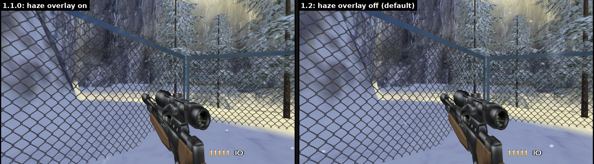
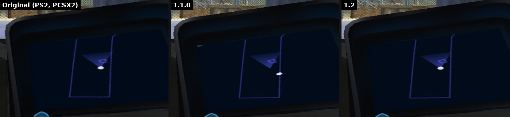

# Version 1.2 - patch notes

**Updating**
- Windows and Linux: the launcher offers the update by itself. Only the changed files are downloaded, your saves are backed up first, then the game is rebuilt once from your disc. That takes a few minutes.
- Steam Deck: download 1.2 once by hand. The launcher did not open on SteamOS before, so it could not update itself. From now on it can.

## Picture

| Before (1.1.0) | Now (1.2) |
|---|---|
| At higher resolutions a second, shifted copy of the picture lay on top of it: double edges in the distance and a ghost image while turning (#9) | The game's haze overlay is off by default. You can turn it back on in the in-game menu under Picture ("Original haze overlay") |
| A copy of the frame the game draws onto itself every frame was read slightly off at higher resolutions | It now lines up exactly at every resolution |
| The player dot on the Temporal Uplink map slid away from the view cone in widescreen (#12) | The dot sits under the view cone again, like on the PS2 |
| Through the sniper scope the picture was brighter and washed out, on wide screens the edges showed a shifted older picture | The scope looks like the original |

## Weapons and mouse aiming

| Before (1.1.0) | Now (1.2) |
|---|---|
| Switching to the Sniper Rifle (for example from the pistol) brought the scope up at once, picking up the AK or the Sniper Rifle went straight into the aim view | The aim mode pauses for a moment on every weapon change and pickup, the scope only opens with the zoom key |
| Soviet S47, AK, Vintage Rifle and other zoom weapons stayed zoomed in, also right after picking them up or after cycling weapons with the D-pad (#5, #10) | Zoom only while you hold or tap the zoom key. D-pad up/down only zoom while the zoom key is held |
| After the Sniper Rifle, other weapons zoomed in when aiming | Fixed |
| Vintage Rifle scope could get stuck or flicker | Fixed |
| Fully zoomed in, the mouse turned far too fast (#13) | Mouse speed follows the zoom level, like in modern shooters. Your zoom sensitivity setting still works on top |
| With mouse aiming you got off turrets right away (dam boss in Siberia, Planet X) (#6) | You stay on the turret and steer it with the mouse (#8) |
| The mouse crosshair showed up in cutscenes (#8) | Hidden in cutscenes |
| The mouse could stop working after a character healed you above your maximum health (Neo Tokyo) | Fixed |
| | New: tap the zoom key to open the scope, tap again to close it. Holding still works |
| | New: "Auto-aim (mouse)" in the launcher under Controls. Off by default, so shots go exactly to the crosshair |

The port now reads the weapon in your hand straight from the game. All 30 weapons are known by name.

## Cheats (optional, off by default)

- Infinite health, infinite armor and infinite ammo. Switches in the launcher under Controls and in the in-game menu.
- Only in single player and split screen. They are off in Online+ and in online matches.

## Steam Deck

| Before (1.1.0) | Now (1.2) |
|---|---|
| The launcher did not open on SteamOS | It opens in Desktop Mode and Game Mode and brings everything it needs |
| With Steam Input set to "joystick mouse" the mouse needed a click after every start and pause (#5) | Works right away |
| | Launch option `TS2_DIREKT=1 %command%` starts the game without the launcher |

## Launcher

| Before (1.1.0) | Now (1.2) |
|---|---|
| Settings changed in the in-game menu did not show up in the launcher, saving in the launcher could undo them | The launcher reads them again when the game closes |
| An incomplete download failed without a message | The launcher says the package is incomplete |

## Linux

| Before (1.1.0) | Now (1.2) |
|---|---|
| With the picture effects "Clear" or "Cinematic" the game could crash at start if its folder name has a space | Fixed |

## Online+

| Before (1.1.0) | Now (1.2) |
|---|---|
| Your own kills were missing on the scoreboard and showed as a suicide in the kill feed | Counted for you |
| A small hitch twice a second during matches | Gone |
| | Hit and kill markers are bigger and stay a little longer, the hit sound is louder |

## Setup on Windows

| Before (1.1.0) | Now (1.2) |
|---|---|
| For some people the setup stopped at 68 % (#4) | If that step hangs, the setup ends it after 15 minutes and tries two other ways by itself. We could not reproduce the hang ourselves, so we can't promise it fixes it for everyone |

## How it was tested

- Linux: fresh setup from the finished package, both editions start, the automatic test suite passes (story, sniper, scope tap, deathmatch, Online+ browser and bot match).
- Windows laptop: normal setup through the launcher, game runs at 56 to 62 FPS.
- Steam Deck: setup through the launcher, game runs at 60 FPS.
- Picture: compared with the original game running in PCSX2, same place, same frame.

## Known issues

- Siberia, the twin gun at the dam: with mouse aiming the mouse sometimes turns your character instead of the gun. With a gamepad it works. A fix is in progress.
- Steam Deck: short slowdowns of a few seconds while a level loads (after choosing the profile and when a mission starts), the music slows down with them. Everywhere else it runs at 60 FPS. A fix is planned for the next update.

The full list is in docs/KNOWN_ISSUES.md.

## Thank you

Every one of these fixes started with a report. Thanks to parabolee, SamuelDowse, SusDTSteve, Signorken, peterhelfer785-svg, ElusiveClarity, HURG-IIDX, SilveAlter and LeFinnaBust on GitHub, to NonEuclidianMeatloaf, Edgeward34, Plane-Implement9977, BoffinBrain, MediumOdd743, hilyou, Nihil66, GoTeamScotch, Confident_Cow_6221, iMr_PrO_GaMeR, HURG_IIDX, Cheddar_Cheeseman, Wilotas805, Wolfalisk318, Kooky-Bad-5235, THPSJimbles, megamoto85, 0rder66dotexe, SnooChocolates5288, Accomplished_Move861, rxuz, TeslaSupreme, Ayzonfire, deafisit, Kamacurass and sheeplycow on Reddit, and to DoctorCyrax on YouTube. Screenshots and videos help a lot, keep them coming.

And thanks to Lowkas, our Windows tester, who found more bugs by accident than most people find on purpose.

## What comes next

Some reports are already in progress, others are on the list:

- In progress: hipfire with modern controls hitting below and right of the crosshair (#9)
- In progress: the twin gun at the Siberia dam with mouse aiming
- Planned: a quick way to jump to any point of a level for testing, so fixes like the dam gun can be checked much faster
- In progress: difficulty select highlight not covering the whole box (#15)
- In progress: options to tone down or turn off the red hit flash and the muzzle flash
- On the list: walls missing in MapMaker levels (#14)
- On the list: weapons look a bit narrow in widescreen
- On the list: PAL version support, unlimited MapMaker resources, custom maps online
- On the list for 1.3: field of view slider in the launcher, number keys select weapons in the game's order

What we are working on and how far it is, with pictures, is always in the devlog:
https://github.com/Destinity13/TimeSplitters-2-Native-Recomp-Windows-Linux-SteamDeck/blob/main/news/README.md

This project keeps growing, and every bit of support is welcome: reports, tests on your hardware, ideas or just spreading the word.
