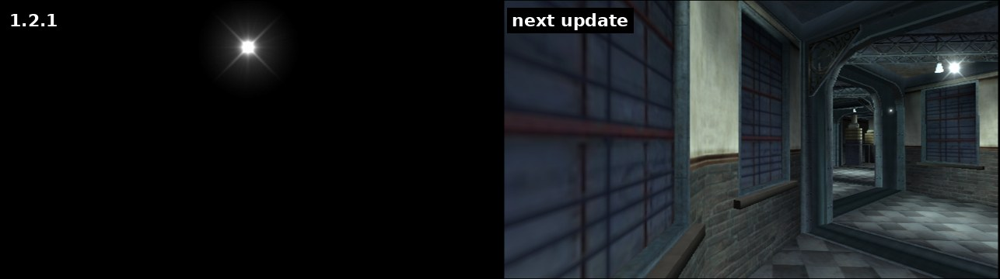

# Devlog: coming in 1.2.2

17 November 2026

A lot happened since 1.2.1. None of this is released yet, it all comes with the next update. Here is where things stand.

## Done and tested

* **MapMaker walls are back (#14).** Levels made in the MapMaker had no walls, you could only see the lights and walked into things you could not see. The MapMaker lights every wall when a map loads, and the port got one rare instruction in that code wrong. All walls were drawn, just fully transparent. Fixed, the built in sample maps look like the original again. Thanks SusDTSteve for the report!

* **Sniper zoom with a controller (#13).** The right stick now slows down while zoomed, the same way the mouse does. Thanks SamuelDowse!
* **Overlapping letters in the pause menu (#16).** Fixed.

## New: low stimulus options

For players who are sensitive to flashing or fast changes on screen. We can't promise anything medical, we just try our best.

* Hit tint: turns down the red full screen flash when you take damage
* Health arc: makes the health arc at the side less strong
* Soft scene cuts: after a hard camera cut the picture fades in instead of jumping

## First look: PAL version

Until now the port only works with the USA disc. Today the European disc (SLES-50877) booted for the first time, with German menus, the intro and the first level. It uses the same port code as the USA version and runs at 60 Hz, so both should feel the same. The goal is one download that works with either disc, and PAL and USA players in the same online match.

This is early. It is not in 1.2.2 yet and still needs a lot of testing.

## Still open

* Getting on a turret a second time at the Siberia dam (#18)
* The highlight bar in the difficulty menu is a bit short in widescreen (#15)
* HD texture packs not showing up for some of you (#17). If you have this, a log file helps a lot.

## How we found the MapMaker bug

We run the original game in PCSX2 and the port side by side with the same button presses, then compare screenshots and now also the game's memory. For the MapMaker that showed the walls were all there, only their colours were wrong. From there it was one function.

Lowkas helped test again. He found zero bugs and one new way to get lost in the options menu.

Thanks for all the reports, screenshots and videos. Please keep them coming.
