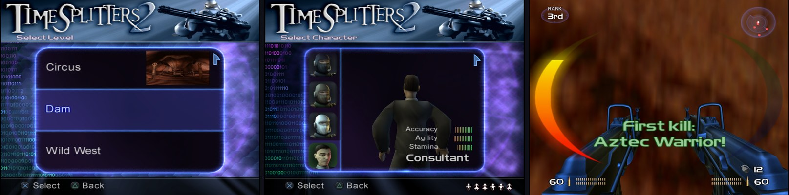

# Devlog: hidden content is coming back

18 November 2026

TimeSplitters 2 has a lot of things on the disc that never made it into the game. Characters without an unlock, maps that were taken out of Arcade, weapons with no slot, a whole MapMaker tile set. We started bringing them back. Nothing here is released yet, it all comes with the next update.

## What works right now

* **The Consultant.** He is in the Arcade character select, at the end of the list, and plays like any other character.
* **Dam and Wild West in Arcade.** Both are back in the map list and run full deathmatches with bots at 60 fps.
* **Hidden weapons.** Desert Eagle, Desert Eagle (x2), Mox, Silenced Luger and Gun Powder show up in custom weapon sets.
* **MapMaker, twice the room.** Maps can use twice as much tile memory as before. We tested a map twice the old size: it builds and plays.
* **The Gothic tile set.** The cut fourth tile set of the MapMaker is unlocked.
* **Extended Easy Mode.** On Easy the game cuts levels short. A new option lets you play the full levels on Easy. Normal and Hard don't change. This one is built in but not tested in game yet.

All of it works with your own disc, USA and PAL. No ISO patching, no cheat device, no mod files. Every part can be switched off if you want the game exactly as it shipped.

## Thanks

A big thank you to **YossarianAssyrian** for the Vanilla+ patch. It was our guide for the Consultant, the Arcade maps and the weapons. Thanks also to TCRF and to the cheat code community, who documented a lot of this years ago. The Gothic tiles and Extended Easy Mode come from their codes.

## Also in the next update

* **Number keys for weapons are gone again.** The last devlog announced them. They got in the way more than they helped, so we took them out.
* **Rumble** is stronger and both motors are the right way round.
* **Turret at the Siberia dam.** We found why getting on only worked sometimes. It should work every time now, tell us if it doesn't.
* **Lights** stay where they belong in widescreen.
* **The game window** opens on the monitor your mouse is on and has its own icon on Linux.

## What we try next

The harder stuff: the cut Arcade levels, the Capture the Bag crash on Chinese, unused characters like Gasmask Special and John Vattic, the Electrotool alt fire and co-op in MapMaker maps. Some of it may not work out. We will tell you either way.

Lowkas picked the Consultant right away. He says the suit finally makes him look like he has a real job.

Thanks for all the reports and videos. Keep them coming.
