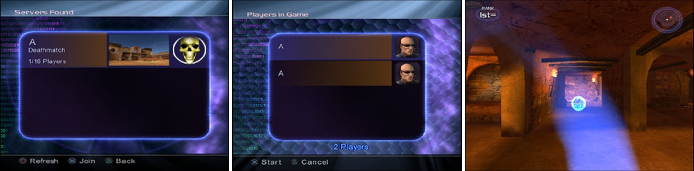

# Devlog: one download for both discs

18 November 2026

The last devlog said the PAL version had just booted for the first time. Since then it went a lot further than planned. Nothing here is released yet, it all comes with 1.2.2.

## PAL and USA are now one port

* **One download, either disc.** The setup checks which disc you have and builds the port for it. USA (SLUS-20314) and Europe (SLES-50877) are both supported, you don't need to pick anything.
* **Same game, same features.** Cheats, mouse aiming, controller aiming, HD textures, widescreen, Online+, MapMaker, the low stimulus options: everything we built for the USA version works on the PAL disc too. We tested both side by side.
* **60 Hz on PAL.** The European disc runs at the same speed as the USA one, timers and all.
* **English by default.** Both versions start in English.
* **Shared saves.** Your profile and your MapMaker maps are in the same place for both discs. Switch discs and your progress is still there.
* **PAL and USA in one match.** A PAL player can join a game hosted by a USA player and the other way round.

## New and fixed

* **Rumble.** Controller vibration was never wired up. It is now, for DualShock, Xbox and other pads. Thanks to julius belmont on YouTube for pointing it out!
* **Number keys for weapons.** 1 takes your first weapon, 2 your second and so on, in the order you have them. A key without a weapon does nothing.
* **Field of view with the mouse.** The slider now holds its value while you play with the mouse. Before it jumped back to 60 at times.
* **Sniper crosshair.** After a short right click the crosshair could stay on screen inside the scope. Fixed.
* **Turret at the Siberia dam (#18, #11).** Getting on a second time should work now. We could not test this one automatically, so tell us if it still acts up.

## Still open

* **Weapon position at a high field of view.** The world gets wider, but the gun in your hand moves towards the middle of the screen and the scope frame gets smaller. The game draws the gun with the same view as the world, so this needs its own fix. Working on it.
* The highlight bar in the difficulty menu is a bit short in widescreen (#15)
* HD texture packs not showing up for some of you (#17). A log file helps a lot.

## How we test now

Every package gets the same run before anyone sees it: a fresh setup with both discs, a deathmatch with cheats, field of view and mouse aiming on, an Online+ bot match with the kill feed, a MapMaker map, and the six regression cases in both regions. Only when all of that passes does it go out.

Lowkas tested the PAL build and found the sniper crosshair bug within five minutes. He says it was skill. We say he held right click by accident.

Thanks for all the reports, comments and videos. Keep them coming.
