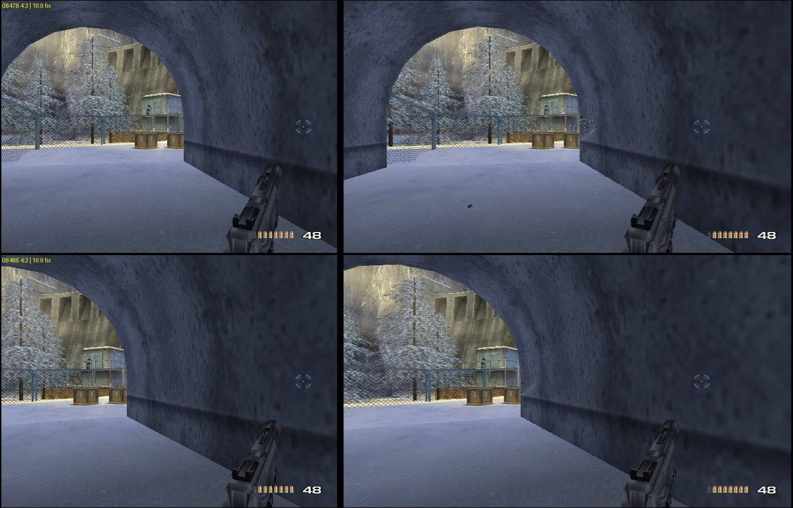
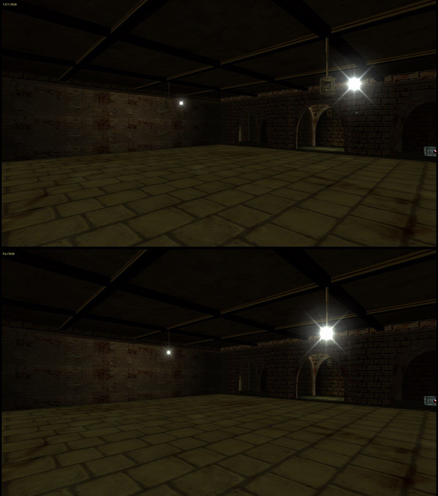
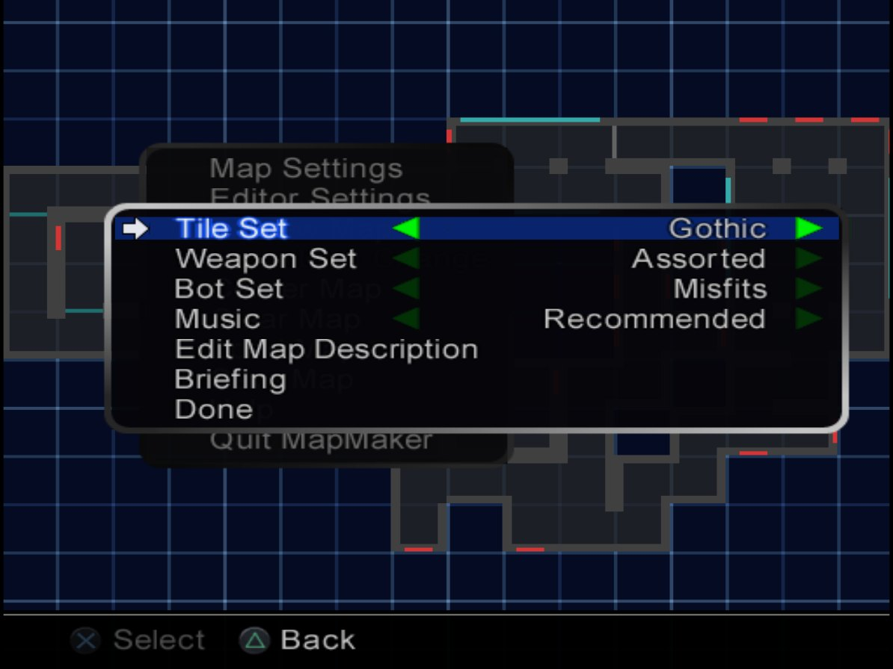

# Crystal Cut 1.3.2 patch notes

The first widescreen patch. Just start the launcher and press Update. Your saves and settings are kept, and the game is linked once more automatically (takes a few minutes). Fresh installs can grab the full package from the [release page](https://github.com/Destinity13/TimeSplitters-2-Native-Recomp-Windows-Linux-SteamDeck/releases/tag/v1.3.2).

## Your shots land where the crosshair is

In aim mode the crosshair can move away from the center before the view starts turning. In widescreen it was drawn too far out once it left the center, so your shots went somewhere else. Aiming at a head and hitting the wall next to it was not your fault.

The game itself always aimed right. Our own widescreen layer keeps the HUD in its 4:3 shape and pushes HUD elements in the outer thirds to the screen edge. It treated the crosshair like a HUD element. Now the game tells us every frame where the crosshair is, and it stays exactly where the game fires. We checked it left, right, up, down and diagonal, on the USA and the PAL disc.

This also clears up the "invisible box" feeling with the sniper scope. The view now starts turning exactly where the crosshair stops.

Thanks a lot to parabolee (#20) and MikerMoo (#21) for the great reports and clips!

## Light glows sit on the lamps again

The bright glow of lamps sat next to the lamp in widescreen, the further from the center the more. Same cause, the glow is a 2D sprite and got pushed like the HUD. Now it stays on the lamp and keeps its round shape.

## The Gothic tile set has its real name

In the MapMaker the restored Gothic tile set showed up as "4". The menu reads the tile set names from a small list in the game, and the Gothic set never got its entry. The name itself was on the disc all along, right after "Alien" in the game's own text table. It now shows "Gothic". Thanks to patzilla777 for pointing it out!

## Tested before release

- Collective test on USA and PAL (story, sniper scope, deathmatch with bots, menus, bot match), all passed
- Fresh install from the release package for both discs
- Full play test of exactly this package, all at 60 FPS without a single error

## Still on the list

What we're working on next is in the [devlog](2026-11-21-devlog-whats-next.md).

Special thanks to Lukas, who as always tested the Windows side, and who still swears his crosshair was always perfect. It wasn't, Lukas. It really wasn't.
