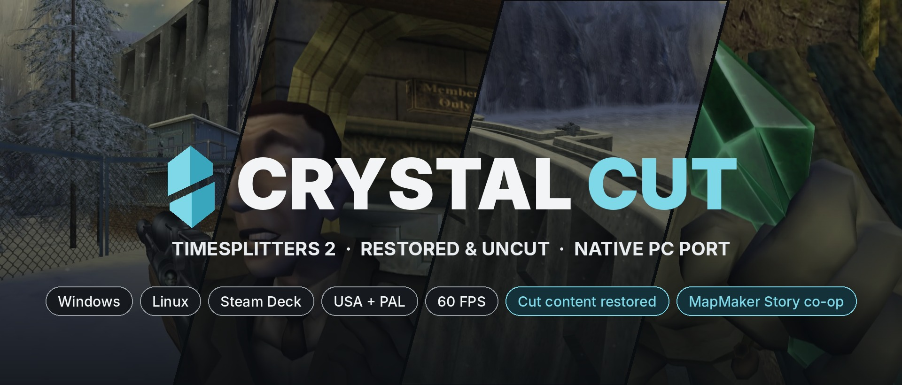

# Back to work: polish first, no new features

After a few quiet days, work on Crystal Cut is back on, and with a clear rule: **no new features until everything that is already in the game runs properly.**

We put out a lot of new stuff very fast, and you found a lot of rough edges. Thank you for every report, every screenshot and every clip. 1.3.2 also didn't fix the aiming as fully as we said it would, and we want to be honest about that.

So here is how it goes from now on:

- Every open report from GitHub, Reddit and the RecompLauncher page is collected in one list, 27 points right now.
- **Graphics come first:** the broken textures in the level select (#23), the bouncing and jitter when turning, odd HUD effects, stutter, the Virus flame next to the player in widescreen (#28), stretched screen edges (#16) and the MapMaker tile offset.
- **Then gameplay:** hip fire not landing on the crosshair (#25, #21), the sniper scope not panning and scope aiming on controller (#30), turrets from odd angles (#24), bots spawning on one spot in Arcade, the FOV slider, and the setup crash on CPUs without AVX2 (#26).
- Every bug gets a fixed test first, then the fix, then a check against the original game. The test stays in our automatic test run, so the same bug can't sneak back in.
- The next update comes when the list is done and the exact release package is tested on Linux, Windows and Steam Deck, not before.

We also got a second test PC for exactly this, so more setups get tested before anything goes out.

Found something that is not on the list yet? Open an issue or drop a comment on Reddit or YouTube. A screenshot or short clip plus `app/build/play.log` helps a ton.
