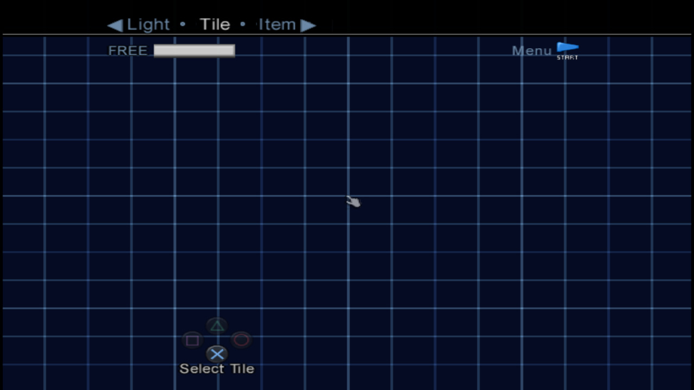
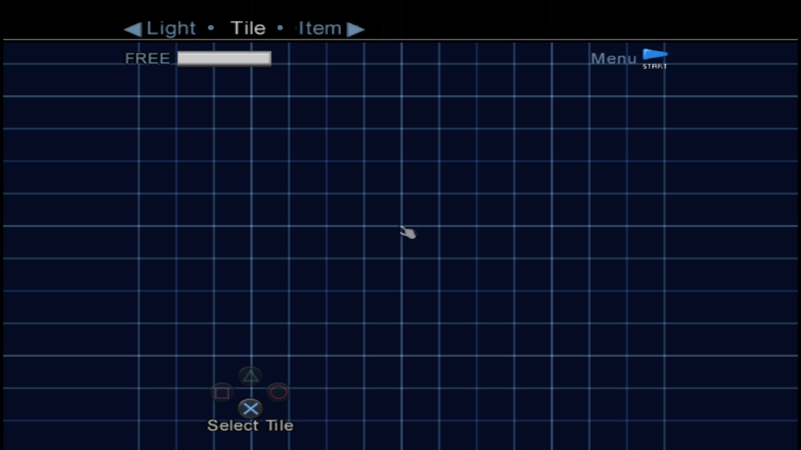
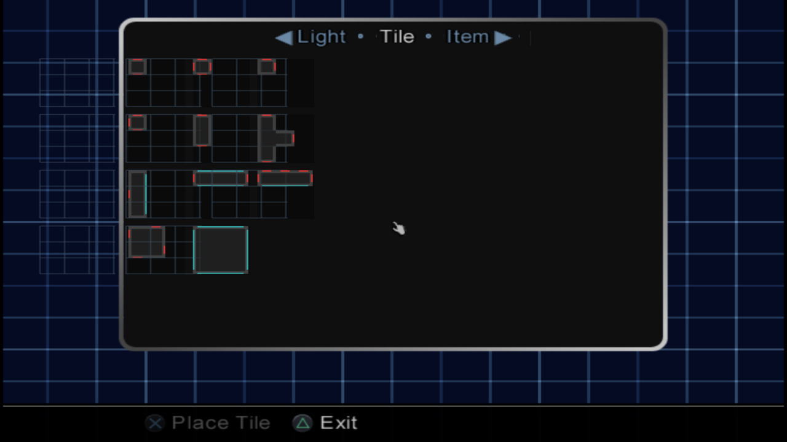
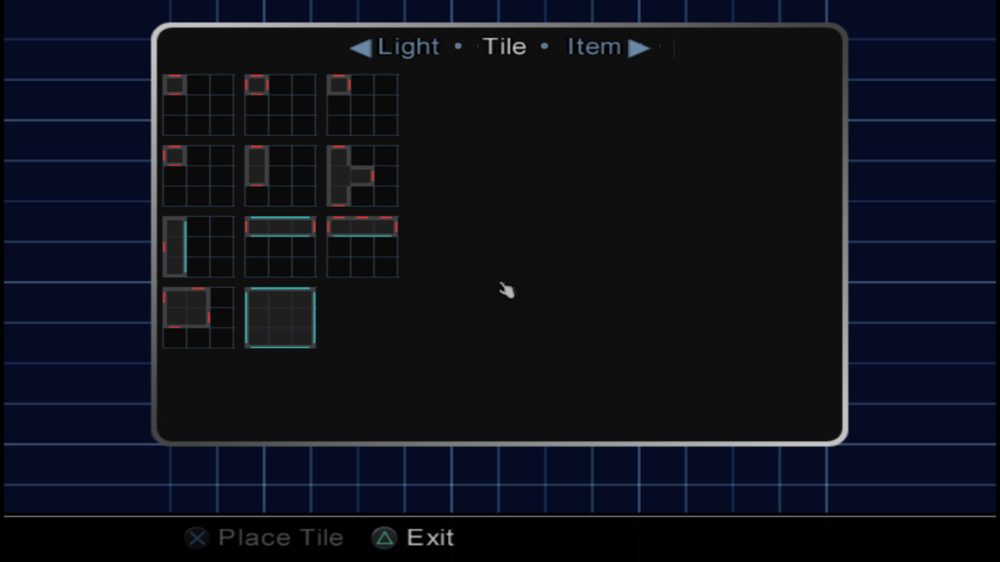
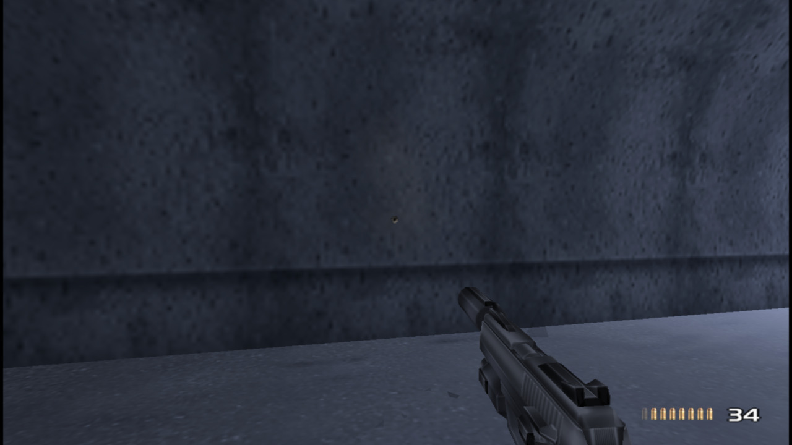

# Why widescreen is the hard part, and where we are

A quick word on where most of the current bugs come from, what is already fixed and what comes next.

## 4:3 runs the game as it was made

In 4:3 the port runs TimeSplitters 2 the way it was built for the PS2. Most of the problems you report only show up in widescreen, and there is a reason for that.

Widescreen patches for emulators mostly change the camera and stretch the picture. The game itself never knows about it, so the HUD, the crosshair and the effects just stay where they were, slightly stretched. Those patches never touch any of the things below.

Crystal Cut is different. The whole game is rebuilt natively for your PC, and real widescreen is part of that. Every piece of the game that was made for a 4:3 TV has to be adjusted by hand. That means the HUD, crosshairs, light glows, fire, menus, the MapMaker editor and mouse aiming. TimeSplitters 2 has a lot of these spots, and many of them only appear in one mode, on one map or with certain settings. That is why some of them only surface over time.

So when something looks off in widescreen, it is almost always one of those spots we have not found yet. Every report with a screenshot or a short clip lets us find and fix another one. The fix then gets its own automatic test, so it cannot quietly come back.

If you just want to play right now without any of this, switch to 4:3 in the settings and you get the game exactly as it was.

## Fixed and checked, coming with the next update

**MapMaker editor.** The grid was stretched to the full widescreen width while the cursor and the tiles stayed in 4:3, so a tile could land one cell away from where the cursor pointed. Now grid, cursor and tiles share the same layout. The ghost frame next to the tile picker is gone as well.

| Before | After |
|---|---|
|  |  |
|  |  |

**Setup on Linux stopping at "VU1 decoding produced nothing"** (#26). That setup step no longer needs the Vulkan renderer, so a missing graphics library can no longer stop it. The result is byte for byte the same as before.

## Fixed, final checks running

**Hip fire and the crosshair** (#25, #21). We measured this one properly. The shot itself lands exactly in the middle of the screen.

The problem was our own crosshair dot. It was drawn in the middle of the visible part of the picture instead of the middle of the whole picture, so it sat a little up and to the left of where the shots go. That is fixed now.

**Bouncing and jitter while turning with V-Sync on.** The game ran on its own exact 60 Hz clock while most monitors run at 59.94 or 60.01 Hz. Every few seconds a frame was shown twice or skipped. The game now follows the refresh rate of your monitor when it is close to 60 Hz, like PCSX2's "Sync to host refresh rate". On 120 or 144 Hz monitors, VRR (G-Sync or FreeSync) or a 120 Hz mode gives the smoothest picture.

**Sniper scopes on a controller far too twitchy** (#13, #30). Zoomed in, the turn speed now follows the zoom on a gamepad too, not only with the mouse.

**Light and fire cores beside burning players** (#28). Moving lights now keep their place in widescreen, the same way the lamp glows have since 1.3.2.

**Setup on older CPUs without AVX2.** Setup now checks the CPU and builds without AVX2 where it is missing.

## Still on the list

Textures breaking on Windows (#23), team icons above heads in Team Deathmatch (#28), stretched text at the screen edge (#16), screen shake in Siberia (#31), the sniper scope not panning (#21), turrets started from an odd angle (#24), the challenge timer counting too much when the frame rate drops, the Windows launcher being blocked by Windows itself on some PCs, and performance including a steady 60 FPS on Steam Deck. The full list is in the [polish list devlog](2026-11-24-devlog-polish-list.md).

## Thank you

To everyone who reports bugs, posts screenshots and records clips, thank you. You are the reason these spots get found. Please keep them coming, either as an issue here or as a comment on Reddit or YouTube. A screenshot plus `app/build/play.log` helps a lot.
