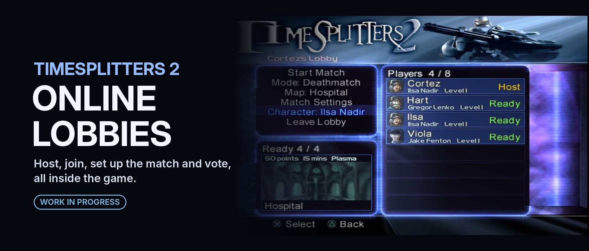
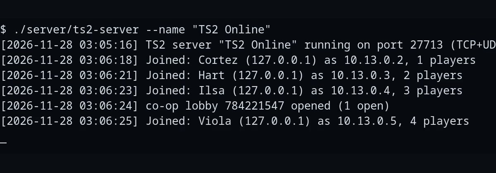
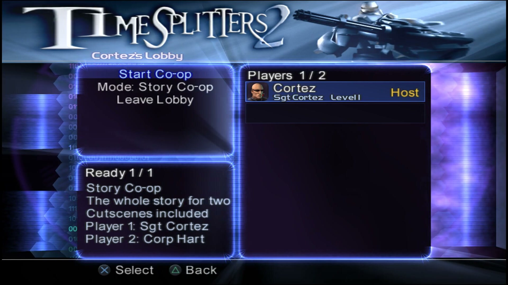
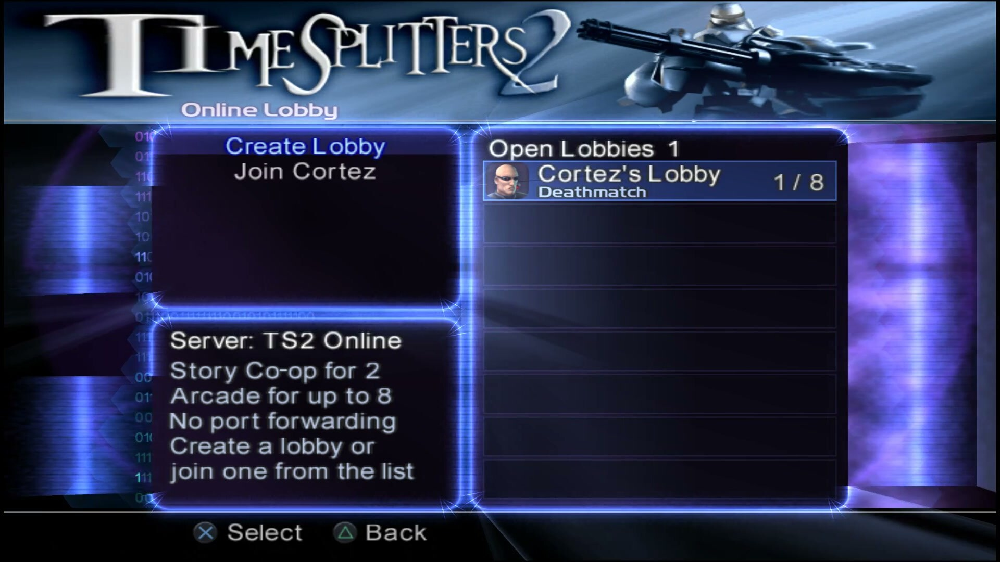
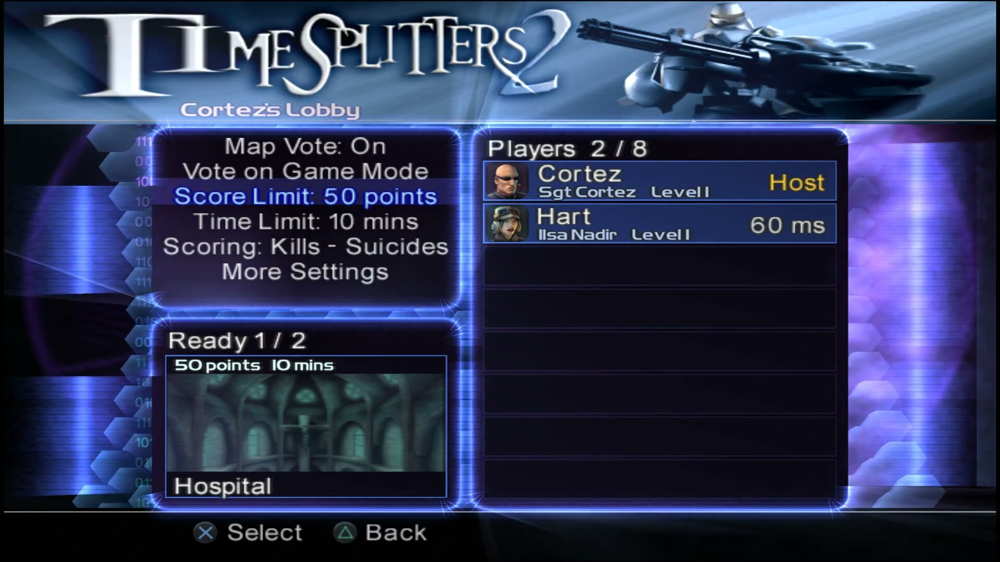
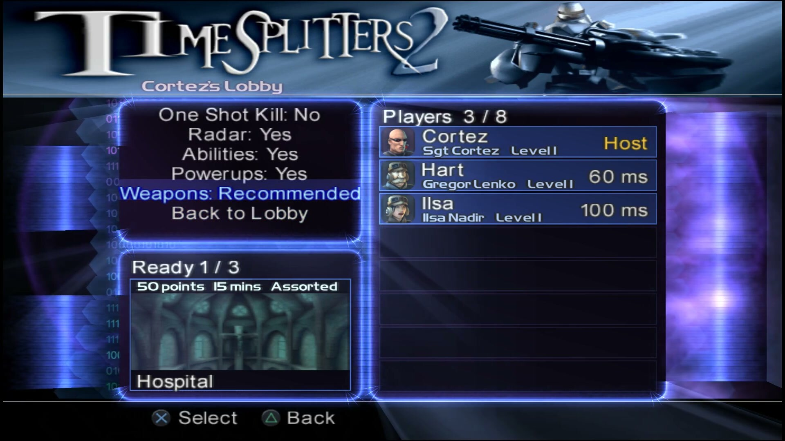
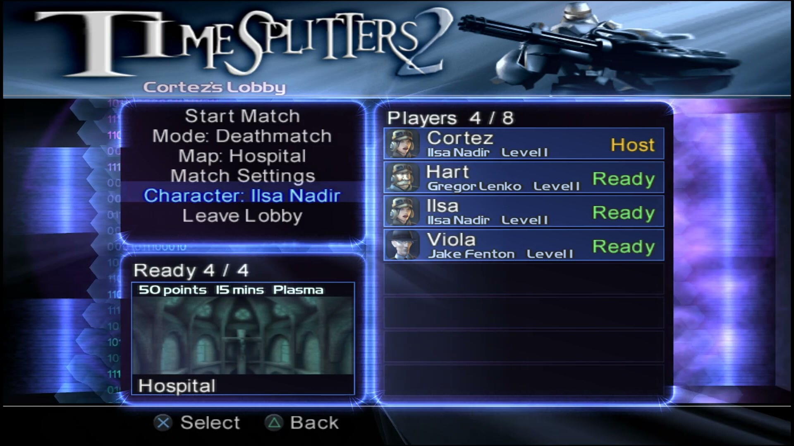
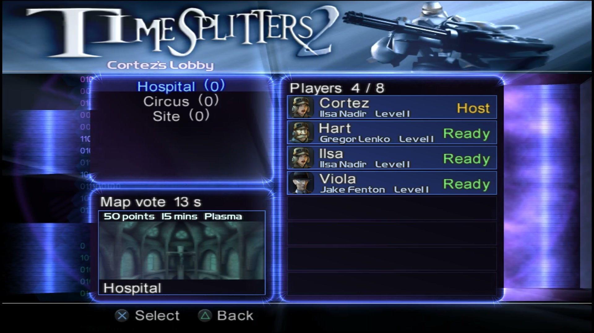
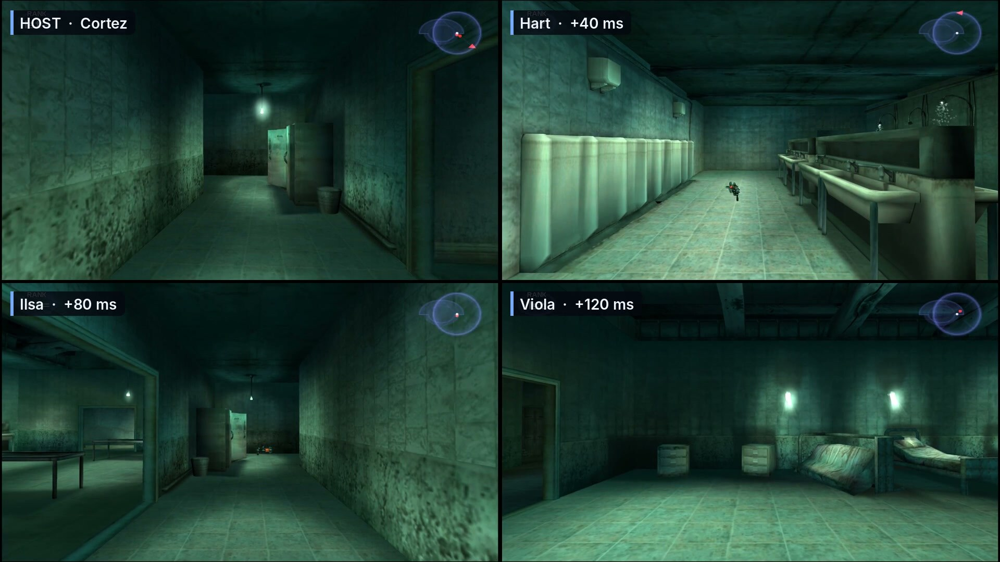
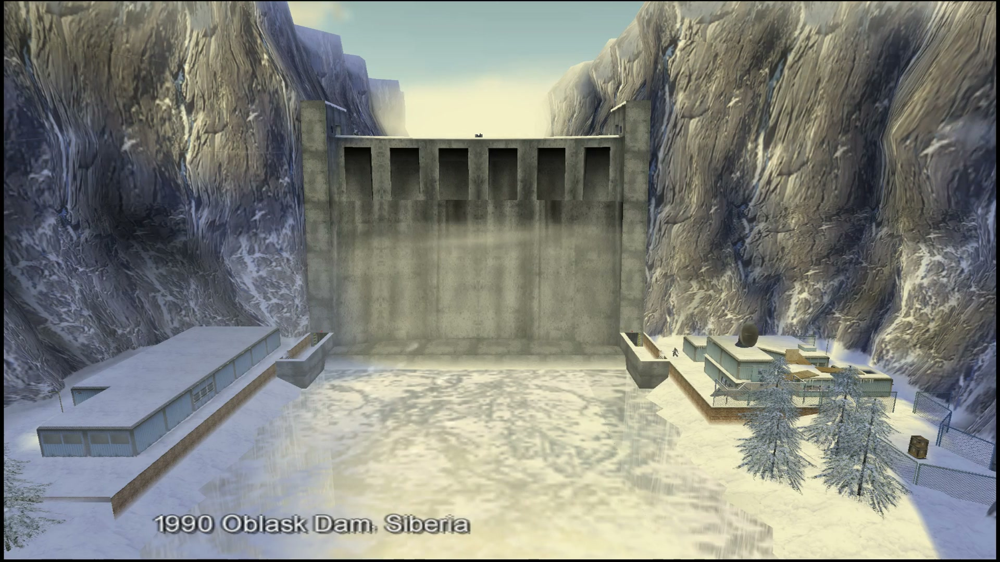

# Online lobbies are coming to TimeSplitters 2

On the PS2, TimeSplitters 2 only had a LAN mode for the network adapter. Since 1.0 the port can already take that LAN mode online: everyone on the same server meets in Arcade, Network, as if they were on one LAN. It works, but it still feels like 2002. The host sets everything up alone in the old menus, everyone else waits in a list of names, and there is no real place to meet and talk it over before the game starts.

So we are building what the game never had: a real online lobby. A lobby list, a host who sets up the match, players who join with one press, and a vote on the map. Everything happens inside the game, in the game's own menus. No overlay, no extra window, no tool on the side.

It is not in a release yet. But it works, and we want to show you how far it already is.

## Step 1: someone starts a server

One command and the server is up. It is a small program that comes with the game, for Windows and Linux.

Whoever runs the server opens one port on their router. Everyone else just plays. The players never have to touch their router, the server passes everything along.

## Step 2: the host creates a lobby

Main menu, Online+, Online Lobby, Create Lobby. That's it. The host picks the mode and the map right there.

## Step 3: everyone else sees it

Your friends open the Online Lobby and your lobby is already in the list, with your character, the mode, the map and how many players are in. When the host changes the mode or the map, the list updates live. Pick it, press Join, you're in.

## Step 4: the host sets up the match

The match settings are the game's own Arcade options, and you only get the ones that make sense for the mode you picked. Score limit, time limit, scoring, one shot kill, radar, abilities, powerups and the weapon set.

A Deathmatch lobby stays a Deathmatch lobby. If the group wants something else, the host can start a vote on the game mode, and the settings switch over to fit the new one.

## Step 5: pick your character and ready up

Every player gets a bar in the lobby: character portrait, name, status and ping. Up to 8 players in Arcade, 2 in Story Co-op. In team modes the bars turn red and blue, so you see the teams before the match even starts.

## Step 6: vote for the map

When the host starts, everyone gets 15 seconds to vote. Three maps, most votes wins.

## Step 7: play

And then everybody is in the same match.

## Story Co-op online

The story can be played in co-op through the same lobby. Both players run the game in step with each other, and yes, the cutscenes play. The Siberia intro runs for both players at the same moment.

One honest note: right now each player still sees the split screen of the original co-op mode. Giving every player a full screen of their own is next on the list.

## How we test it

Before it goes anywhere near a release, we beat it up on one PC: four copies of the game at the same time, three of them with an artificial delay of 40, 80 and 120 ms. All four go through the lobby, vote and end up in the same match. Everything in this post, including the screenshots, comes from those runs. The players are driven by scripted controller input, they press the same buttons you would.

That test already found real bugs. One of them could leave a player stuck in the character select forever if a button press landed in the middle of a screen change. That one is fixed.

## What is still missing

We'd rather tell you now than later:

- **A public server that is always on.** Right now you need someone who runs one. For "start the game and see every lobby", there has to be a server that never sleeps. That is the next big step.
- **A real test over the internet,** with players in different places. So far everything ran on one machine.
- **A full screen for each player in Story Co-op,** instead of the split screen.
- **A proper loading screen** between the lobby and the match. At the moment you can watch the game set the match up in the background.
- **Bots in online matches.** The game's network mode has no bots, so we have to add them ourselves.
- More testing of every single match setting.

There is no date yet. It comes out when it works the way it should.

## Thank you

You keep asking for online play in the comments, on Reddit and on GitHub, and that is exactly why it moved to the top of the list. Thank you!

And thanks to Lukas, who has already announced that he will be the first player to rage quit an online match of TimeSplitters 2 in over twenty years. We believe him.
